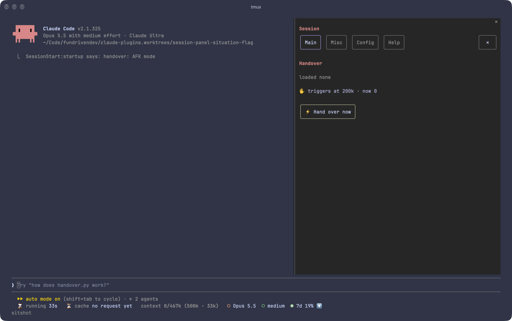

# session-mods

Two mods for a Claude Code session, drawn by the engine: a calm side pane with what every sub-agent was asked and did, and a one-row bar beneath the prompt with the session's live figures.



## Install

```
/plugin marketplace add FunDrivenDev/claude-plugins
/plugin install session-mods@fundrivendev
```

Each version's changes are in the [`session-mods-v*` releases](https://github.com/FunDrivenDev/claude-plugins/releases?q=session-mods-v&expanded=true).

The pane opens at session start when the terminal is at least 144 columns wide; `/session-panel` opens it at any width. The bar shows beneath the prompt from the start.

## The pane

It gathers the session's handover, its topic's live state, and its issue, pull requests, documents and git changes in one place.

- **Title and tabs**: the session's topic as a title (also sent to `/rename`), and four tabs: Main (Handover, and Situation when turned on), Misc (the rest), Config and Help.
- **Handover**: the `handover` plugin's status, the handover loaded and written, buttons to hand over now or start the next session, and AFK mode, turned on with a goal or off from the pane where the session can relay.
- **Situation** (opt-in, off by default): the topic's merge plan with its pull requests' live state, its workers in the terminal session's other tabs, its open questions and the decisions awaiting you, read live from the notes and `gh`.
- **Issue and Git**: the tracker issue the session is about, then each repository it touched with its pull request and worktree.
- **Documents**: the artifacts, handovers, plans and notes the session wrote, linked.
- **Last prompt**: your last prompt, with the whole session's prompt history one click away.
- **Steps**: an audit trail of the main loop, with refusals, failures and repeated actions flagged.
- **Sub-agents**: every sub-agent, background agent and teammate, with its task and history on demand.
- **Git diff and history**: the uncommitted changes as a tree and the commits made since the session began.
- **Colours**: Catppuccin Frappé, switching to light twins with the macOS appearance.

## The bar

How long the session has run, when the prompt cache expires, how full the context is, the 5-hour and 7-day quotas, and the model and effort, each switchable with a click. It sits beneath the engine's own hint line, which stays in place. See [Bar](docs/bar.md).

## Configuration

| Option | Values | Default | What it sets |
|---|---|---|---|
| `cacheTtl` | `1h`, `5m` | `1h` | The prompt-cache lifetime the bar's countdown starts from; a model switch reports the real one. |
| `situation` | `true`, `false` | `false` | Shows the Situation section on Main. Off, nothing is read for it. |
| `rename` | `true`, `false` | `true` | The pane's title also names the session (`/rename`), and the agent gets the `session_title` tool and its reminder. Off, the title only heads the pane, so another tool can own the session's name. |

Besides `situation` and `rename`, the pane reads Claude Code's `plansDirectory` and the handover plugin's settings. See [Configuration](docs/configuration.md), which also says how to turn Situation on and renaming off.

## Documentation

- [Top bar](docs/top-bar.md): the pane's title, tabs and colours
- [Main tab](docs/main-tab.md): Handover, and the opt-in Situation
- [Misc tab](docs/misc-tab.md): Issue, Git, Documents, Last prompt, Steps, Sub-agents, Git diff and Git History
- [Bar](docs/bar.md): the bar beneath the prompt, item by item
- [Configuration](docs/configuration.md): opening the pane, settings and limits
- [Development](docs/development.md): tests, validation and type-checking
