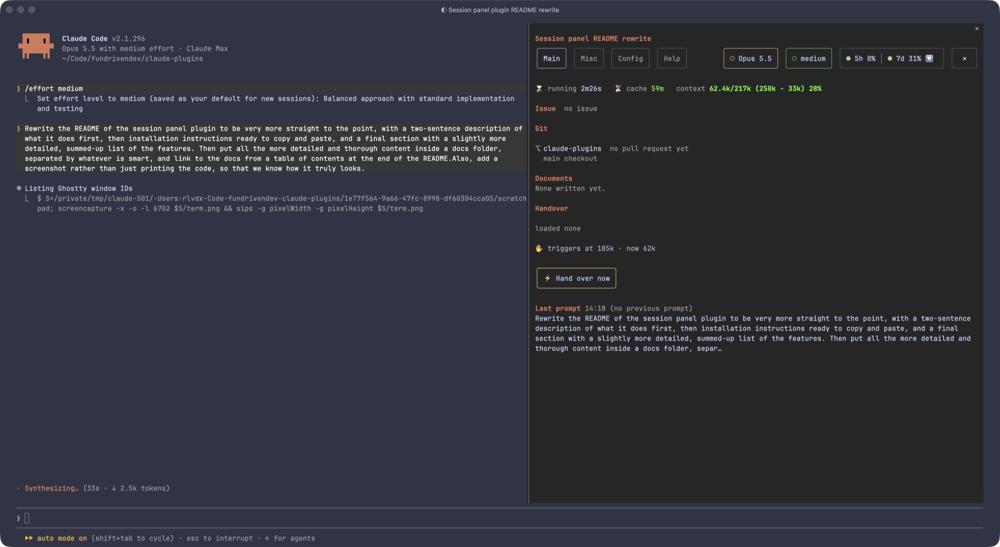

# session-panel

A calm side pane for a Claude Code session: what every sub-agent was asked and did. It also gathers the session's issue, pull requests, documents, handover and git changes in one place, drawn by the engine as a mod.



## Install

```
/plugin marketplace add FunDrivenDev/claude-plugins
/plugin install session-panel@fundrivendev
```

The pane opens at session start when the terminal is at least 144 columns wide; `/session-panel` opens it at any width.

## Features

- **Title and tabs**: the session's topic as a title (also sent to `/rename`), and four tabs: Main, Misc, Config and Help.
- **Issue and Git**: the tracker issue the session is about, then each repository it touched with its pull request and worktree.
- **Documents**: the artifacts, handovers, plans and notes the session wrote, linked.
- **Handover**: the `handover` plugin's status, the handover loaded and written, and buttons to hand over now or start the next session.
- **Last prompt**: your last prompt, with the whole session's prompt history one click away.
- **Steps**: an audit trail of the main loop, with refusals, failures and repeated actions flagged.
- **Sub-agents**: every sub-agent, background agent and teammate, with its task and history on demand.
- **Git diff and history**: the uncommitted changes as a tree and the commits made since the session began.
- **Colours**: Catppuccin Frappé, switching to light twins with the macOS appearance.

## Documentation

- [Top bar](docs/top-bar.md): title, tabs and colours
- [Main tab](docs/main-tab.md): Issue, Git, Documents, Handover and Last prompt
- [Misc tab](docs/misc-tab.md): Steps, Sub-agents, Git diff and Git History
- [Configuration](docs/configuration.md): opening the pane, settings and limits
- [Development](docs/development.md): tests, validation and type-checking
