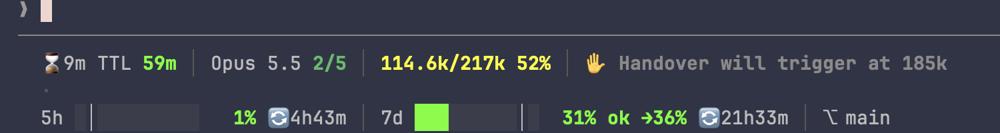

# statusline

> **Deprecated**: no longer maintained. It keeps working as installed, but gets no new features or fixes.

A Claude Code status line built around what ends a session's memory (auto-compaction) and what makes it expensive (an expired prompt cache, the quotas). Two lines show the context against the real compaction point, the cache countdown, the quota pace, and the git branch and pull request.



## Install

```
/plugin marketplace add FunDrivenDev/claude-plugins
/plugin install statusline@fundrivendev
/statusline:install
```

Needs `bash`, `jq` 1.6 or later, and `git`. `/statusline:uninstall` puts your previous status line back.

## Features

- **Session and cache**: the session's age and the minutes left before the prompt cache expires, then `EXP` once it has.
- **Model and effort**: the model, the effort out of 5 in `/effort`'s colours, fast mode and thinking off.
- **Context**: the tokens against the auto-compact trigger, not the model's window, graded green to red, then `⚠ COMPACTING`.
- **Quotas**: 5-hour and 7-day usage bars with an even-pace mark, a verdict projected to the reset, and the time to it.
- **Git**: the branch, a `*` when tracked files changed, the worktree, and the PR number with its review state.
- **Plugin segments**: any plugin can add a segment by shipping a `statusline-segment` executable, like the handover plugin's.
- **Never slow**: git and the plugin segments are computed in the background and shown one refresh later.
- **Never blank**: a bad setting or a missing `jq` shows a warning in the line instead of breaking it.

## Documentation

- [Layout](docs/layout.md): what each segment of the two lines shows
- [Install and uninstall](docs/install.md): what `/statusline:install` changes, and how to go back
- [Settings](docs/settings.md): the environment variables and their defaults
- [Segments](docs/segments.md): plugin segments, and the lazy git and segment refresh
